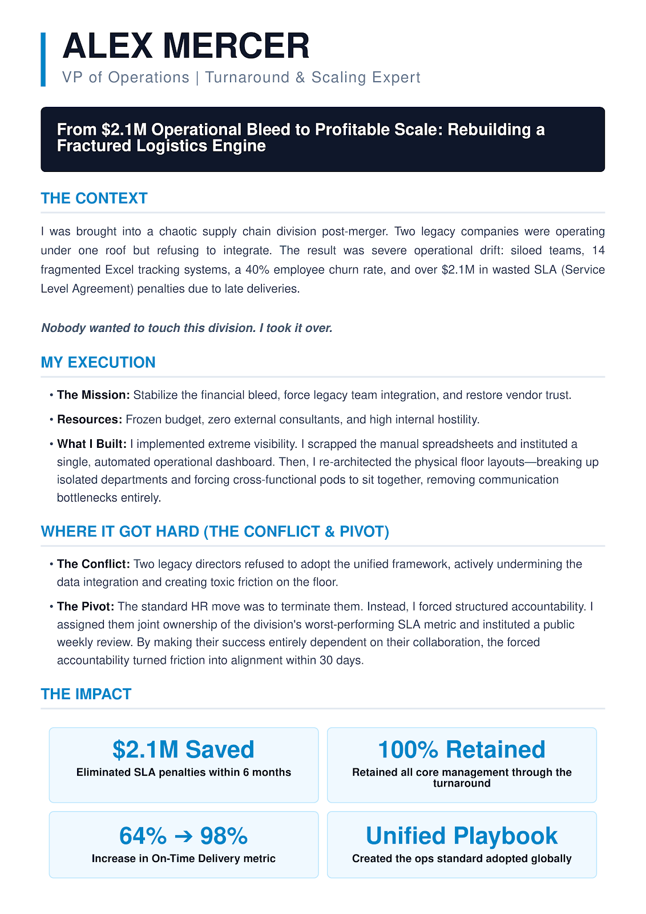

# Impact Page Prompt

**A free AI prompt that turns one line on your resume into an Impact Page: a one-page case study of your best professional moment.**

Works in ChatGPT, Claude, Gemini, or any custom GPT / Gem. No code, no setup.



## Why this exists

Most of what makes you good at your job barely survives a job interview. The interviewer is busy, under time pressure, and it isn't their job to dig your real story out of you. Even when it does come out, it disappears the moment the conversation ends.

An Impact Page is the fix: one page, about 400 words, that tells a single achievement in full. What was broken, what you did, what went wrong along the way, and how it ended. Think of it as a case study about you.

I built this after 53 one-on-one conversations with job seekers. Almost every time, a strong story was hiding under a dry resume bullet that nobody had ever asked about. This prompt does the asking.

## How it works

You upload your resume and paste the prompt. It runs in three phases:

1. **Find the opportunity.** It reads your resume and points to 2-3 lines that probably hide a story. Most people can't spot their own, so it spots them for you.
2. **Interview.** You pick one, and it interviews you one question at a time. It pushes back when you're vague, asks what *you* did when you say "we", and won't let a number slide without a baseline.
3. **Write.** It writes the page in a fixed structure, then lists every place where it had to guess so you can fix those before sharing.

## How to use it

1. Open a **new** chat in ChatGPT, Claude, or Gemini.
2. Upload your resume.
3. Paste the prompt from [`prompt.md`](prompt.md).
4. Answer the questions. If your tool has voice mode, use it. Talking is easier than typing.
5. Read the result out loud. Fix anything you wouldn't say in a meeting, and check every number.

The prompt tells the model to reply in the language you write in, so it works in Hebrew or any other language.

**Using it as a custom GPT or Gemini Gem:** paste the prompt into the instructions field, and in your first message just upload your resume.

## What you get

```
Name, role
Headline: "How I [action] to [result]"
Context line: Company · Role at the time · Years
Context
Execution: Mission · Resources · Preparation · Conflict · Pivot
Results: 2-3 numbers
Looking at 2026: how you'd do it today with AI
```

## A few honest notes

- It's a first draft, not a finished page. The quality depends on how specific your answers are.
- It is built not to invent. Anything missing is marked `[to fill in]`. Fill those in with real details or cut the claim.
- Keep the conflict section. A story where nothing went wrong reads like a press release, and nobody believes it.

## Read more

The full guide, with what a good Impact Page looks like and why it matters: **[link to article on sun-dahan.com]**

---

Built by [Sun Dahan](https://www.linkedin.com/in/sundahan/). Part of an ongoing thesis on why hiring keeps missing the person it's actually looking for.
